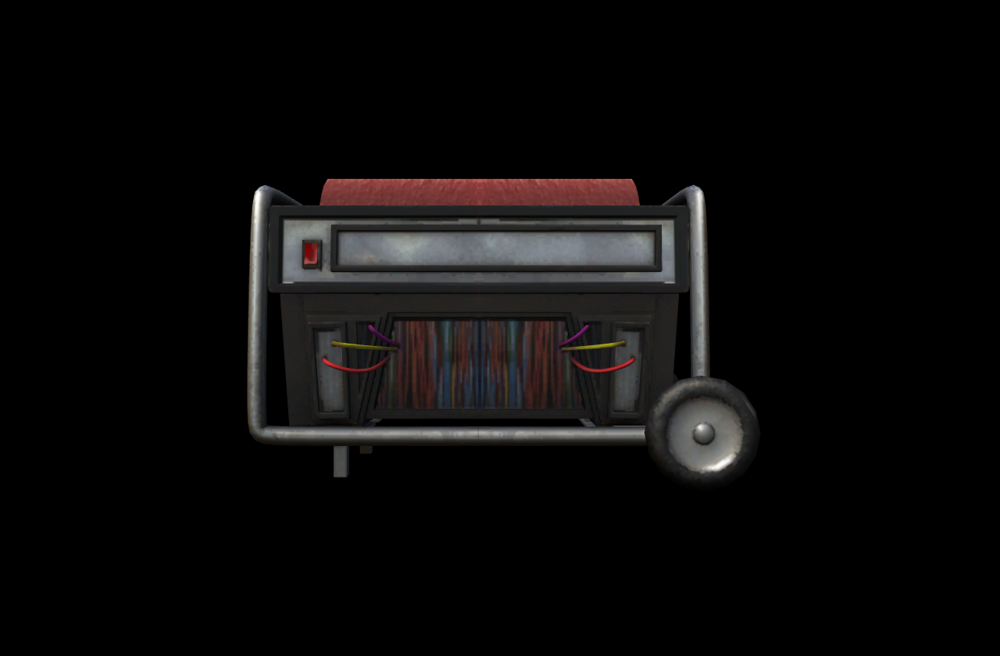

# Generator Simulator

An unofficial Windows fan game about repairing generators by connecting matching wires.

**[Download the latest release](https://github.com/masashira0212-stack/generator-simulator/releases/latest)**

## Download and play

1. Open the latest release using the link above.
2. Download `GeneratorSimulator.exe`.
3. Run `GeneratorSimulator.exe`.

No Python installation is required. Requires 64-bit Windows and an OpenGL-compatible graphics environment.

## Controls

- Click a generator to open its repair screen.
- Click and drag to connect points with matching numbers.
- Press **Esc** to leave the repair screen.
- In the final puzzle, use **Ctrl + mouse wheel** to zoom and the **mouse wheel** to scroll vertically.

## Reporting issues

Open an issue with your game version, steps to reproduce the problem, and a screenshot if possible.

## Credits

This is not an official Roblox or FORSAKEN project. See [CREDITS.md](CREDITS.md) for asset sources and license information.

This repository hosts documentation and downloadable builds. It does not include the game's complete editable source code.
